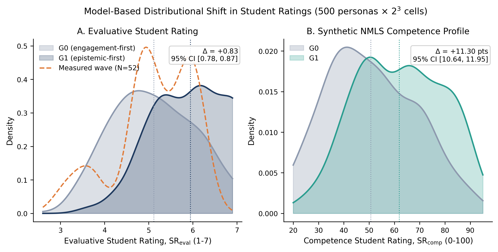
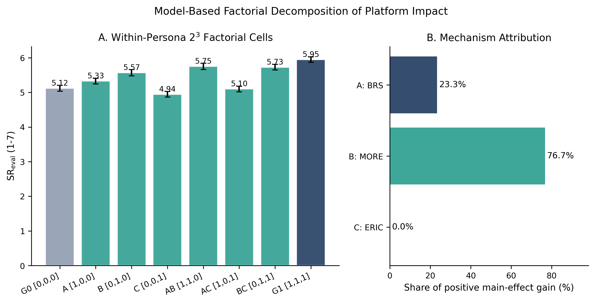
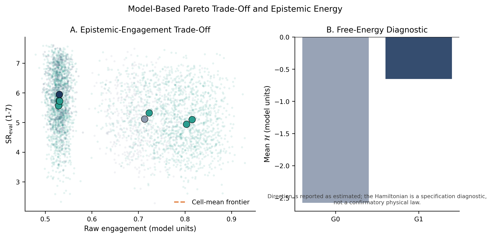
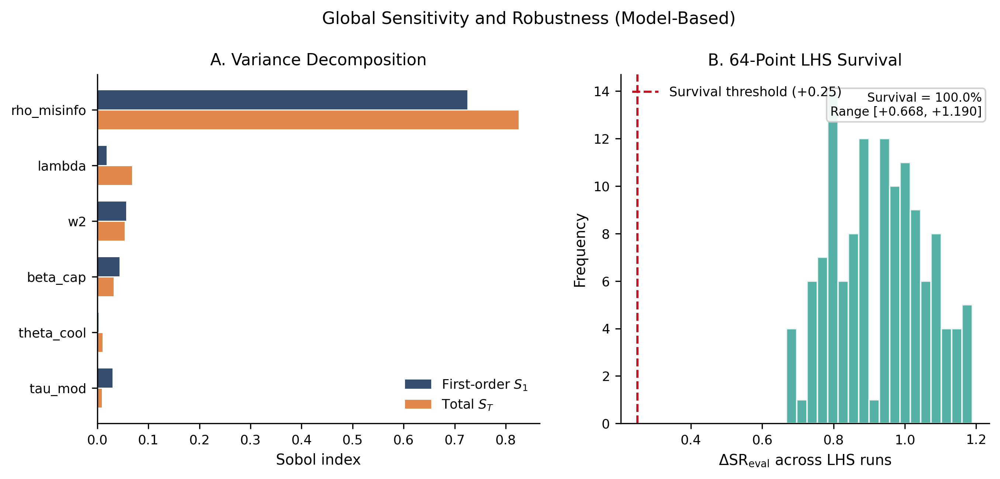
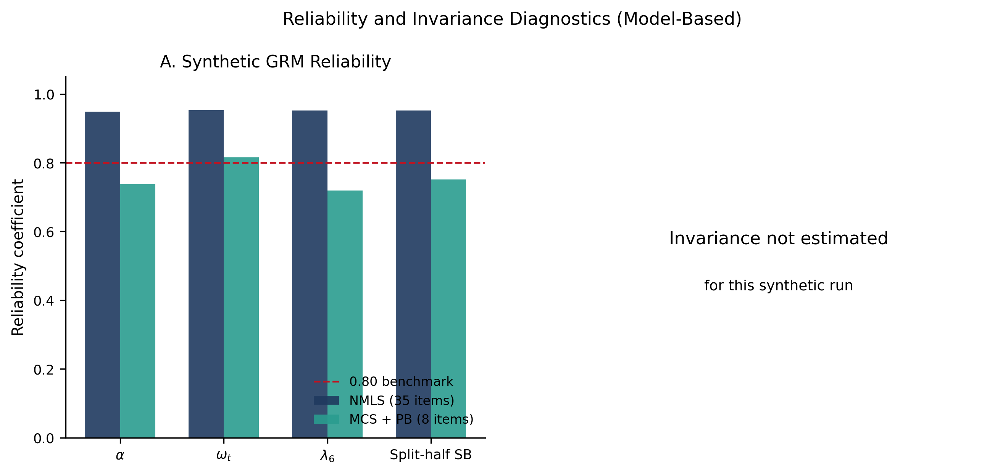
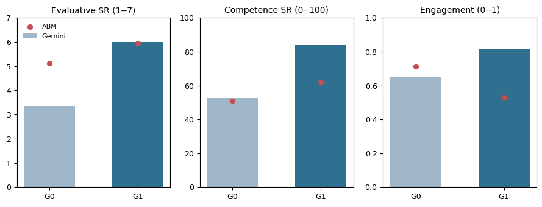
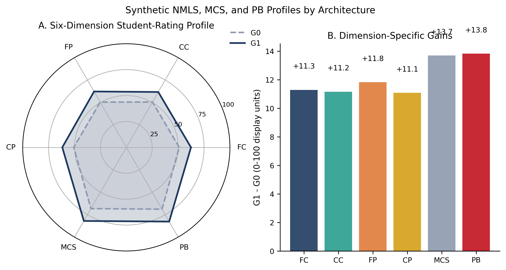
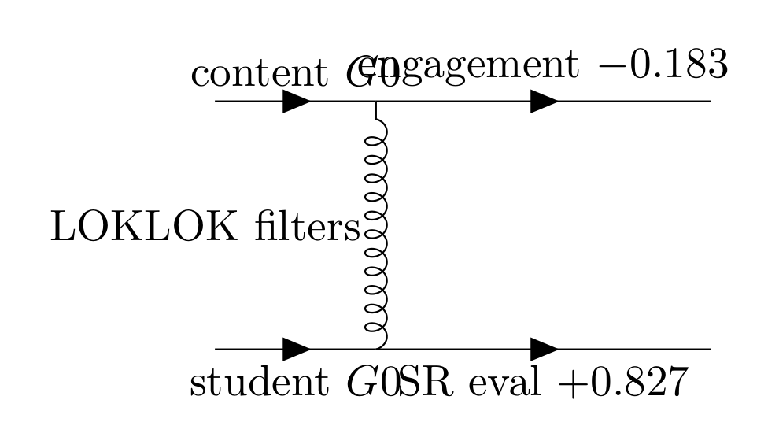

# LOKLOK

## The Social Media Radio Innovation and Its Impact on University Students' Ratings: An Exploratory Study

A master's thesis and its complete web companion: Epistemic Systems Theory, the LOKLOK platform, a measured student wave, and a calibrated in-silico experiment, published as a classical academic website with an interactive laboratory. This README contains the full thesis digest: research questions, hypotheses, framework, methods, every result table, figures, and the browsable source code.

**Author:** Sherif Rashwan
**Degree:** M.A. Defense, Media Innovations, Faculty of Mass Communication, Ahram Canadian University
**Supervisors:** Dr. Engi Aboul-Ezz (Beni Suef University) and Dr. Mostafa El Banna (Ahram Canadian University)
**Date:** November 2026

| Resource | Link |
| --- | --- |
| Live thesis website | [srashwan.github.io/loklok/thesis](https://srashwan.github.io/loklok/thesis/) |
| Read page by page | [thesis/read](https://srashwan.github.io/loklok/thesis/read/) |
| Interactive laboratory | [thesis/interactive](https://srashwan.github.io/loklok/thesis/interactive/) |
| Full thesis PDF (366 pages) | [thesis_final.pdf](https://srashwan.github.io/loklok/thesis/thesis_final.pdf) |
| Bilingual supervisor summary | [Supervisor_Summary_EN_AR.pdf](https://srashwan.github.io/loklok/thesis/Supervisor_Summary_EN_AR.pdf) |
| Defense presentation | [PDF](https://srashwan.github.io/loklok/thesis/LOKLOK_Defense.pdf) / [PPTX](https://srashwan.github.io/loklok/thesis/LOKLOK_Defense.pptx) / [HTML](https://srashwan.github.io/loklok/thesis/LOKLOK_Defense.html) |
| Feynman-diagram supplement | [Feynman_Supplementary.pdf](https://srashwan.github.io/loklok/thesis/Feynman_Supplementary.pdf) |
| Machine-readable thesis data | [data/thesis_data.json](https://srashwan.github.io/loklok/thesis/data/thesis_data.json) |
| Browsable source code | [static/thesis/code](static/thesis/code/) |

**At a glance:** 366 pages | 43/43 automated package checks | 500 synthetic personas | 2^3 = 8 design cells | 18 sessions | 256-point joint sweep (96.5% positive) | 25-code qualitative codebook | 10 Feynman diagrams | 5 interactive applets.

---

## 1. The question

Platform design, audience measurement, and epistemic quality are usually studied in
separate literatures. This thesis joins them with one question: **can a social media
radio platform be designed so that university students judge what they hear more
carefully, without losing the audience?**

Because no live trial was possible, the evidence is organized in three layers with a
strict claim hierarchy:

1. **The measured layer.** A questionnaire from 52 students (60 collected, 8 duplicate
   vectors removed) riding Uber in 6th of October City, Giza. It anchors the model; it
   is not a causal test.
2. **The qualitative layer.** A focus-group transcript and a researcher self-report,
   193 usable segments coded by three independent human coders on a 25-code codebook.
   Machine coding met the pre-set usability gate for no mechanism code, so this layer
   is an assumption audit, reported honestly as a null result.
3. **The modelling layer.** A calibrated in-silico experiment: 500 synthetic personas,
   8 design cells, 18 sessions, GRM-IRT scoring, with the G0 arm anchored to the
   measured mean.

## 2. Research questions and hypotheses

| # | Research question | Proposition |
| --- | --- | --- |
| RQ1 | Does platform architecture shape structural credibility and audience evaluation? | EST-P1 |
| RQ2 | Do diversity and cooling mechanisms constrain epistemic concentration? | EST-P2 |
| RQ3 | Can the proposed instruments meet basic psychometric accountability? | EST-P3 |
| RQ4 | Do the EST constructs integrate into a coherent measurement model? | EST-P4 |
| RQ5 | Which mechanisms and weights drive the model-based contrast? | Results, Section 6.10 |
| RQ6 | What does a Gemini persona-agent pilot add to the comparison? | Section 6.13 |

| # | Hypothesis | Status |
| --- | --- | --- |
| H1 | Structural credibility: architecture shapes credibility and evaluation | Partial, model-conditional |
| H2 | Diversity mechanism: diversity and cooling constrain epistemic concentration | Supported within the model |
| H3 | Psychometric validity: instruments meet psychometric accountability | Mixed: reliability yes, structural validity no |
| H4 | Integration: EST constructs form a coherent measurement model | Not established |
| H5 | DeGroot conformity (exploratory) | Exploratory, no confirmatory claim |
| H6 | Scheduling and duration (exploratory) | Exploratory, no confirmatory claim |
| H7 | Participatory performance: the educational test | Prospective, untested |

## 3. Epistemic Systems Theory

| Proposition | Statement |
| --- | --- |
| EST-P1 | Architecture is a structural condition of credibility |
| EST-P2 | Diversity and cooling constrain epistemic concentration |
| EST-P3 | Measurement is an accountability requirement |
| EST-P4 | Participation and evidence-based production are the educational test |

## 4. The LOKLOK platform

| Component | Role |
| --- | --- |
| BRS | Broadcaster Reputation Score: a reputational anchor for every source |
| MORE | Recommendations constrained to keep viewpoints varied |
| ERIC | Moderation loop: reflect, invite, correct |
| Echo Meter | Measures and visualizes echo exposure |
| Algorithmic Cooling | Cools echo-susceptibility when it exceeds a threshold |
| Zewail-inspired gate | Time-resolved attentional coherence between evidence and retention |
| Measurement surface | Evaluative and competence-format student ratings |

## 5. Method in one page

**Measured wave.** N = 52 of 60 questionnaires; university students riding Uber in
6th of October City, Giza. Instruments: an 11-item broadcaster-rating battery (BRS,
alpha .957), a 5-item perceived-benefit battery (PB, alpha .947, omega .962), a star
rating, ride duration, interaction level, and context items.

**Qualitative corpus.** A 160-segment FGD transcript, a 185-segment self-report
transcript, 60 participant-observation accounts, and 4,828 corpus documents. The
codebook has 25 binary codes: 12 deductive mechanism codes (C01-C12) and 13 inductive
codes (I01-I13). Three independent human coders labelled 193 usable segments.

**In-silico experiment.** The 52 rows are debiased with DML + IPW and projected onto
a spectral manifold (condition number 4.82); 500 personas are drawn from the fitted
distribution Q0. Each persona is cloned across the 8 A/B/C cells and run for 18
sessions through eight filters (Hamiltonian, Laplace, Lyapunov, DeGroot, Lagrange,
Hilbert, Percolation, Entropy). Terminal states are scored by a Samejima GRM-IRT
model: a 35-item NMLS competence profile and an 8-item MCS+PB battery. G0 is anchored
to the measured PB mean of 5.119. All state-outcome weights are **declared design
assumptions**, not estimates.

## 6. Results

### 6.1 Headline contrast (G1 vs G0, 500 personas, 18 sessions)

| Outcome | Estimate | 95% interval | t(499) | Cohen's d |
| --- | --- | --- | --- | --- |
| Evaluative student rating (1-7) | +0.827 | [0.779, 0.875] | 33.93 | 1.52 |
| Competence-format rating (0-100) | +11.30 | [10.64, 11.95] | 33.74 | 1.51 |
| Engagement (0-1) | -0.183 | [-0.188, -0.178] | -74.41 | -3.33 |

Intervals describe variation across generated personas, not human sampling precision.
The engagement cost is -0.217 on the terminal-session measure used by the
triangulation designs; both measures are reported.

### 6.2 Full-factorial decomposition

| Effect | Value | Reading |
| --- | --- | --- |
| A (BRS) | +0.1905 | Smaller main effect |
| B (diversity/cooling) | +0.6265 | The dominant path |
| C (ERIC moderation) | -0.0121 | Near zero alone |
| A x B | +0.0216 | Small |
| A x C | -0.0084 | Small |
| B x C | +0.3791 | Nearly half the total contrast |
| A x B x C | +0.0886 | Small |

### 6.3 The 256-point joint sweep

Varying six mechanism parameters and five state-outcome weights, including zero:
median +0.567 (IQR [0.383, 0.802]), mean +0.593, range -0.244 to +1.810, **96.5% of
draws positive**. Top partial rank correlations: diversity-to-credibility **+0.77**,
BRS-to-credibility +0.31, echo-to-credibility -0.27. The result depends chiefly on
one declared link: exposure diversity to perceived credibility.

### 6.4 Randomized-assignment triangulation

| Design | Worlds | Delta SR eval | Delta engagement |
| --- | --- | --- | --- |
| Within-persona | 1 | +0.827 | -0.217 |
| Agent-randomized | 40 | +0.630 [0.384, 0.851] | -0.232 |
| Design-based (no interference) | 400 | +0.807 [0.470, 1.109] | -0.217 |
| Cluster-randomized | 20 | +0.659 [0.338, 0.948] | -0.226 |

B stays near +0.63 in every design. A collapses from +0.190 to +0.038 [-0.075, 0.131]
between agents and recovers to +0.182 [0.011, 0.336] in the interference-free design:
BRS diffusion is the interference-sensitive component. B x C stays positive in effect
terms (+0.379 to +0.430).

### 6.5 Controls, stress tests, and topologies

| Check | Result |
| --- | --- |
| Placebo factor D (absent from the equations) | -0.003 SR eval, -0.082 SR comp |
| Pre-treatment negative controls (A/B/C margins) | +0.001, -0.008, 0.000 |
| B raises chosen diversity | +1.299 (SD .032) |
| A raises BRS | +0.019 (SD .002) |
| B x C lowers echo | -0.340 (SD .009) |
| 60-row sensitivity | +0.808 [0.760, 0.856] |
| 50 anchor bootstraps | +0.839 [0.805, 0.884], 100% positive |
| Topologies ER / WS / BA | +0.827 / +0.826 / +0.832 |
| Adversarial content stress (poor-content share 0.763) | +0.636, sign preserved |

### 6.6 The qualitative gate: an honest null result

| Coding pass | Micro-F1 | Outcome |
| --- | --- | --- |
| Human gold (3 coders) | reference | Pairwise kappa .762 / .852 / .861; per-code median .28 (C02) to .95 (I07) |
| Qwen 7B zero-shot | .193 | 0 of 25 usable; 32.0% of quotes fabricated |
| Qwen 7B gold 5-fold | .320 | 0 of 25 usable; 16.1% fabricated |
| Claude first pass | .452 | 2 of 25 usable; no mechanism code |

The pre-set rule (8 positives, kappa at least .60, at most 5% fabrication) was met by
no mechanism code, so E1 to E3 were not eligible; E1 and E2 are reported as
exploratory checks (+0.018 median shift; -0.043 and -0.042 trait shifts) and E3 was
not run. The qualitative layer remains an assumption audit.

### 6.7 GRM-IRT measurement diagnostics

| Battery | alpha | omega | Guttman lambda 6 | Items |
| --- | --- | --- | --- | --- |
| NMLS competence profile | .948 | .953 | .952 | 35 |
| MCS + PB | .738 | .816 | .719 | 8 |

Test-retest ICC .953. These are properties of the generating model, not human
validation; no human NMLS administration is claimed.

### 6.8 Gemini persona-agent pilot

Direction reproduced, magnitude not: +2.650 [2.342, 2.967] versus +0.827; competence
+31.15 versus +11.30; engagement reversed at +0.163 versus -0.183. Cell-level
MAE 0.655, RMSE 0.842, Pearson r = 0.269, Spearman rho = 0.071. A single-shot
appraisal has no 18-session state updates, so it has no mechanism for the engagement
cost.

### 6.9 Proposition verdicts

| Proposition | Hypotheses | Evidence | Verdict |
| --- | --- | --- | --- |
| EST-P1 architecture and credibility | H1, H4, H5 | Measured PB-star and BRS associations; model BRS path | Partial; model-conditional |
| EST-P2 diversity and cooling | H2 | MORE/Lagrange dominant; topology-independent | Supported within the model |
| EST-P3 measurement | H3 | High consistency; poor CFA; no invariance test | Mixed |
| EST-P4 participation | H7 | Prospective task; no human task data | Untested; future work |

## 7. Chapter map

| Chapter | Pages | Contents |
| --- | --- | --- |
| Front matter | i-x | Arabic title page, Arabic abstract, abstract, evidence status and reading guide |
| 1. Introduction | 39-53 | Background, the radio-specific case, problem, aims, objectives, RQs, hypotheses |
| 2. Critical review | 54-72 | Six epistemic dimensions of social media audio |
| 3. Epistemic Systems Theory | 73-95 | EST-P1 to EST-P4 with formal grounding |
| 4. The LOKLOK platform | 96-118 | BRS, MORE, ERIC, cooling, the gate, the measurement surface |
| 5. Methodology | 119-199 | Measured wave, qualitative corpus, in-silico protocol, inference rules |
| 6. Results | 200-255 | Field descriptives, calibrated experiment, trade-off, triangulation |
| 7. Discussion and conclusion | 256-272 | RQ answers, limitations, the deployment plan |
| Appendices A-L | 273-361 | Questionnaire, codebook, audit, defense map, reproducibility archive |

## 8. Figures

All figures are generated from the saved outputs; the full set is browsable on the
[results page](https://srashwan.github.io/loklok/thesis/results.html#figures).

<table>
<tr>
<td align="center"><br><b>Fig. 6.1</b> The model-based shift in student ratings.</td>
<td align="center"><br><b>Fig. 6.2</b> The eight factorial cell means.</td>
</tr>
<tr>
<td align="center"><br><b>Fig. 6.5</b> The epistemic-engagement Pareto structure.</td>
<td align="center"><br><b>Fig. 6.10</b> The joint sweep: one declared link dominates.</td>
</tr>
<tr>
<td align="center"><br><b>Fig. 6.12</b> GRM-IRT reliability diagnostics.</td>
<td align="center"><br><b>Fig. 6.13</b> The Gemini persona-agent pilot.</td>
</tr>
<tr>
<td align="center"><br><b>Fig. 6.3</b> The six-dimension rating profile.</td>
<td align="center"><br><b>Feynman D6</b> The main experiment in particle notation.</td>
</tr>
</table>

## 9. Code

The full reproducible codebase is browsable in this repository under
[`static/thesis/code/`](static/thesis/code/) and served at
[`/thesis/code/`](https://srashwan.github.io/loklok/thesis/code/loklok_pipeline.py):

| File | Purpose |
| --- | --- |
| [code/pipeline/loklok_pipeline.py](static/thesis/code/pipeline/loklok_pipeline.py) | The complete pipeline: debiasing, personas, 8-cell simulation, GRM-IRT, inference |
| [code/pipeline/generate_figures.py](static/thesis/code/pipeline/generate_figures.py) | Every thesis figure from the saved outputs |
| [code/pipeline/run_all.py](static/thesis/code/pipeline/run_all.py) | One-command reproduction entry point |
| [code/abm_randomized/abm_randomized.py](static/thesis/code/abm_randomized/abm_randomized.py) | The four assignment designs and the E1-E3 gate logic |
| [code/qual_human/per_code_reliability.py](static/thesis/code/qual_human/per_code_reliability.py) | Per-code kappa and leave-one-out human reliability |
| [code/R/01_measured_wave.R](static/thesis/code/R/01_measured_wave.R) | Measured-wave descriptives |
| [code/R/02_cfa_invariance.R](static/thesis/code/R/02_cfa_invariance.R) | CFA and invariance procedure |
| [code/R/03_bayes_crosscheck.R](static/thesis/code/R/03_bayes_crosscheck.R) | Bayesian cross-check |
| [code/feynman/](static/thesis/code/feynman/) | All 10 TikZ-Feynman diagrams and the combined supplement |

The engagement cost is produced inside the session loop (a declared state-outcome
mapping, one of five):

```python
# loklok_pipeline.py: the declared engagement mapping (state-mediated branch)
engagement = np.clip(
    0.74
    + 0.35 * (echo - 0.30)
    - 0.10 * (chosen_dbi - 1.00)
    + 0.08 * (prop_exp - p_bar)
    + 0.08 * (g - 0.5)
    + rng.normal(0, 0.05, n_personas),
    0.0,
    1.0,
)
```

The randomized-assignment designs reuse the same eight cells with per-agent switches:

```python
# abm_randomized.py: per-agent BRS switch inside the same session loop
lam = np.where(fA, P.lam_g1, P.lam_g0)
cap = np.where(fA, 1.0 / (1.0 + P.beta_cap * brs), np.ones_like(brs))
A_eff = setup["A_norm"] * cap[None, :]
A_eff = A_eff / (A_eff.sum(axis=1, keepdims=True) + 1e-8)
```

The qualitative gate is implemented, not improvised:

```python
# abm_randomized.py: the pre-set usability gate for E1-E3
def e_gate(qual_summary, gold_csv, min_usable=4):
    usable = [c for c in g[g.decision == "usable"].code_id if c in CODE_LEVER]
    return dict(rule=f"at least {min_usable} of the mechanism codes usable",
                eligible=len(usable) >= min_usable,
                status="eligible" if len(usable) >= min_usable else "not_eligible")
```

Every reported number traces to a CSV or JSON in the validated package; the site's
[`thesis_data.json`](static/thesis/data/thesis_data.json) is generated from those
files, not hand-entered.

## 10. The site

The thesis section is a hand-built static site in a classical academic design
(Cornell and MIT OpenCourseWare conventions): serif display typography, a crimson
and paper palette, small-caps section kickers, double rules, and a module sidebar.
Pages: Overview, Abstract, Reading Guide (with a one-hour short path), Results
(all tables and figures), Downloads, and a page-by-page Reader for all 366 pages
with a searchable table of contents, chapter jumps, keyboard navigation, and a
progress bar.

The interactive laboratory contains nine dependency-free applets: the trade-off
explorer (Pareto frontier with the sweep band), the BRS diffusion simulator (a live
seven-agent reputation network), the eight cells (hoverable factorial explorer), the
Feynman diagram viewer (all ten processes, click-to-explain), the codebook examiner
(per-code agreement against the gate), a real LOKLOK home feed (twelve items ranked
twice under the declared scoring), the pipeline simulator (the rule-based ABM runs
session by session, animated G0 against G1 with component toggles), a Bayesian versus
frequentist inference animation (the +0.827 headline accumulating persona by persona
with three priors), and interactive figures (sweep histogram with a draggable
threshold, Pareto scatter, triangulation forest, rating distributions). Every applet
labels its inputs as declared assumptions and its outputs as illustrative.

## 11. Repository structure

```text
.
├── .github/workflows/hugo.yml        # Hugo build + GitHub Pages deployment
├── config.yml                        # Hugo configuration and navigation
├── content/                          # Personal pages (profile, books, papers, data)
├── layouts/                          # Hugo templates (PaperMod theme overrides)
├── static/
│   ├── thesis/
│   │   ├── index.html                # Overview
│   │   ├── abstract.html             # Abstract
│   │   ├── guide.html                # Reading guide and module map
│   │   ├── results.html              # Results and figures
│   │   ├── downloads.html            # Materials
│   │   ├── css/thesis.css            # Classical academic design system
│   │   ├── js/site.js                # Reveal animations, counters, data helper
│   │   ├── data/thesis_data.json     # All reported numbers, machine-readable
│   │   ├── interactive/              # The five applets
│   │   ├── read/                     # Page-by-page reader (366 pages)
│   │   ├── pages/                    # 1:1 page renders (WebP) + manifest.json
│   │   ├── figures/                  # Thesis figures and Feynman PNGs
│   │   ├── code/                     # Browsable source code (Python, R, LaTeX)
│   │   └── *.pdf, *.pptx             # Manuscript, summaries, deck, supplement
│   └── ...                           # Site-wide assets (images, icons)
└── README.md
```

## 12. Building and deploying

The site is a Hugo 0.138 site with the PaperMod theme; the thesis section is plain
HTML under `static/thesis/` and is copied verbatim at build time.

```bash
# local preview
git clone https://github.com/SRashwan/loklok.git
cd loklok
hugo server

# production build
hugo --minify
```

Pushing to `main` triggers `.github/workflows/hugo.yml`: GitHub Actions installs
Hugo, builds the site into `public/`, uploads it as a Pages artifact, and deploys it
to `https://srashwan.github.io/loklok/`. The `public/` directory is generated and is
not tracked in git.

The page images in `static/thesis/pages/` are rendered from `thesis_final.pdf` with
PyMuPDF at a width of 1000 px; `manifest.json` stores the page count and the table of
contents used by the reader.

## 13. Quality and honesty commitments

- The manuscript is 366 pages with 0 em dashes, no overfull boxes, and no undefined
  references, compiled with pdfLaTeX in three passes.
- The reproducibility package passes 43 of 43 automated checks and ships a SHA-256
  manifest.
- The Arabic front matter and the Arabic supervisor summary are maintained
  alongside the English text; the bilingual summary is 18 pages.
- All figures link back to their source CSVs; the site data JSON is generated from
  the validated outputs, not hand-entered.
- The qualitative machine-coding result is reported as the failure it is; the gate
  was not moved to make it pass.
- Everywhere on the site, measured field evidence, model-based counterfactual
  evidence, theoretical propositions, and prospective plans are kept in separate
  claim tiers.

## 14. Citation

```text
Rashwan, S. (2026). The Social Media Radio Innovation and Its Impact on
University Students' Ratings: An Exploratory Study. Master's thesis, Ahram Canadian
University, Faculty of Mass Communication, Egypt.
```

## 15. Contact

Sherif Rashwan, Teaching Assistant, Radio and Television
Department, Faculty of Mass Communication, Ahram Canadian University.
Email: sherif.rashwan@san3atech.com

---

Copyright (c) 2026 Sherif Rashwan. All model-based numbers are
conditional on the stated design and are not human treatment effects.
